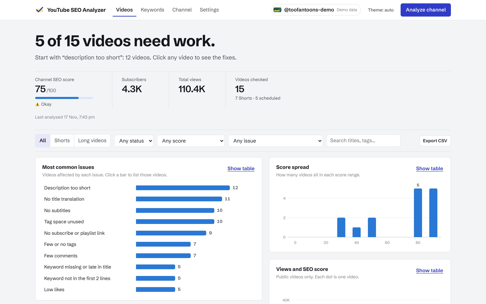

# YouTube SEO Analyzer

A free dashboard that checks the SEO of every video on a YouTube channel and tells you exactly what to fix — without clicking through YouTube Studio one video at a time.

**Live app:** https://vaibhavkumar-wpdev.github.io/youtube-seo-analyzer/



## What it does

- **Scores every video out of 100** using 24 checks on the title, description, tags, thumbnail, subtitles, language, playlists and engagement.
- **Shows the most common problems on your channel** (for example "No chapters on 12 videos") and lets you click straight to those videos.
- **Proofreads each title** the way search shows it: what fits on a phone (about 40 characters), what fits on desktop (about 70), and where it gets cut.
- **Highlights your target keywords** in titles and in the first 150 characters of descriptions (the part people see before "more").
- **Gives copy-ready fixes** for each video: hashtags, a tag list that fits in 500 characters, a chapter template, and a ready-made prompt you can paste into Claude for new titles and descriptions.
- **Checks the channel itself**: description, keywords, trailer, banner, country, language, upload rhythm, playlists.
- **Keyword tools**: how often your target keywords are used, the words you use most, and new ideas from YouTube search suggestions.
- **Tracks your average score over time** (one point each day you press Analyze).
- **Exports** a CSV of every video with its score and issues.
- Works on phones, has a dark theme, and every chart has a table view.

## Privacy

Everything runs in your browser. There is no server and no tracking.
Your API key, settings and saved analyses are stored in your browser's local storage and are only sent to Google's YouTube Data API.
Google sign-in (optional) is read-only, lasts one hour and is never saved.

## Setup (about 5 minutes, one time)

You need a free YouTube Data API key from Google Cloud.

1. Go to [console.cloud.google.com](https://console.cloud.google.com) and sign in.
2. Create a project (for example "YouTube SEO").
3. **APIs & Services → Library →** search **YouTube Data API v3 → Enable**.
4. **APIs & Services → Credentials → Create credentials → API key.** Copy it.
5. Edit the key and lock it down:
   - **Application restrictions → Websites →** add `https://vaibhavkumar-wpdev.github.io/*` (or your own site).
   - **API restrictions →** YouTube Data API v3.
6. Open the app → **Settings** → paste the key, add your channel handle (like `@TadakBoom`) → **Save and analyze**.

The free quota is 10,000 units a day. One full check of a 200-video channel uses about 10–20 units.

### Optional: include scheduled, private and unlisted videos

An API key only sees public videos. To check videos before they go live, sign in with Google (read-only):

1. **OAuth consent screen →** User type **External** → add your own Google account as a **test user**.
2. **Credentials → Create credentials → OAuth client ID → Web application.**
3. **Authorised JavaScript origins:** `https://vaibhavkumar-wpdev.github.io`
4. Paste the Client ID in **Settings → Google sign-in** and press **Sign in with Google**.

## The checks

| Area | Checks |
| --- | --- |
| Title | Length (20–60 for Shorts, 30–70 for videos) · target keyword in the first 40 characters · unique on the channel · not ALL CAPS · max 2 emojis · series or brand name |
| Description | Length (100+ for Shorts, 500+ for videos) · keyword in the first 150 characters · 1–15 hashtags (YouTube ignores all of them above 60) · valid chapters for videos over 3 minutes (start at 0:00, 3 or more, 10+ seconds each) · subscribe or playlist link · not copy-pasted |
| Tags | At least 5 tags · uses more than 150 of 500 characters · includes the target keyword · includes the brand |
| Thumbnail & video | Custom thumbnail (compares the chosen thumbnail with YouTube's auto frames) · subtitles · video and title language set · HD · title translations · in a playlist |
| Engagement | Like rate (4%+ is good) · comments per 1,000 views — only for public videos older than 2 days with 30+ views |

Passed checks count fully, "improve" counts half, "fix" counts zero. Checks that can't be tested (for example a private video's thumbnail) are left out of the score.

## Run it locally

No build step. Any static server works:

```bash
python3 -m http.server 8080
# open http://localhost:8080
```

Add `http://localhost:8080/*` to your API key's website restrictions while testing.

## Built with

Plain HTML, CSS and JavaScript (ES modules), hand-drawn SVG charts, the YouTube Data API v3 and Google Identity Services. No frameworks, no dependencies.

## License

MIT © Vaibhav Kumar. Not affiliated with YouTube or Google.
